# Arkline Furniture: showroom website and admin

A production website for **Arkline Home & Office Furniture**, a custom furniture maker in Novaliches, Quezon City. Customers browse finished projects, order catalogue items or ask for a price on custom work. The shop owner manages requests, photos, prices and website text from a private admin page, without a developer.

**Runs at ₱0 a month** on free plans. **Vanilla JS + Vite · Supabase · Cloudflare Pages.**

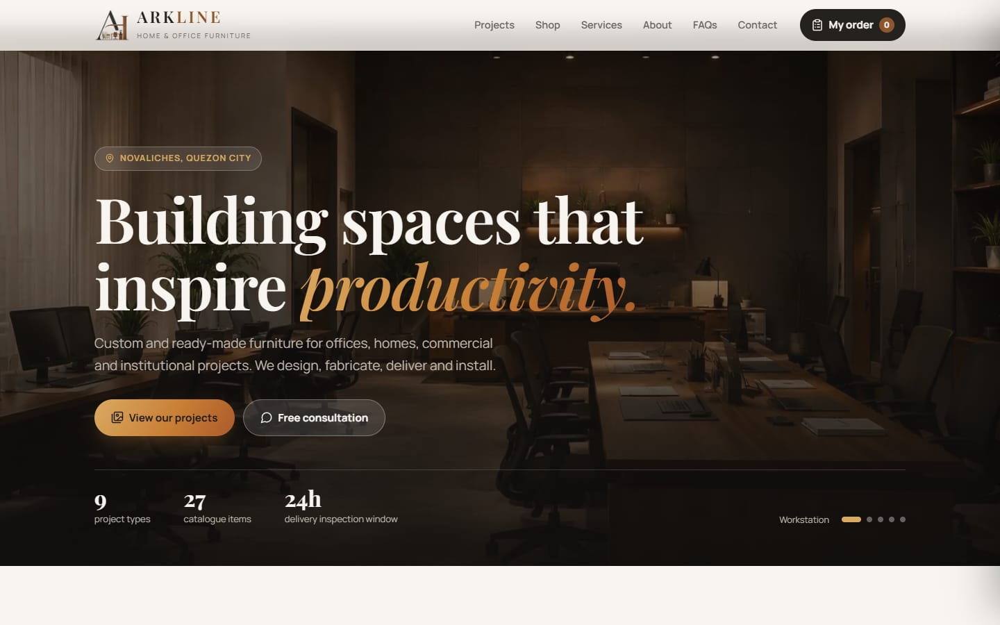

> 📄 **[Website guide (PDF)](docs/arkline-website-flow.pdf)**: how orders reach Arkline · **[Admin guide (PDF)](docs/admin-guide.pdf)**: how the team runs the site · [This README as a PDF](docs/README.pdf)

---

## At a glance

| | |
|---|---|
| **Client** | Arkline Home & Office Furniture (real business, live project) |
| **My role** | Design, front end, back end, database, security, testing, deployment |
| **Stack** | HTML/CSS/vanilla JavaScript (Vite), Supabase (Postgres, Auth, Storage), Cloudflare Pages Functions, Resend |
| **Scale tested** | 100 simultaneous visitors and 100 simultaneous orders, 0 errors |
| **Security tested** | 32 of 32 attack attempts blocked (anonymous and signed-in non-admin) |
| **Cost** | ₱0 a month: every service on its free tier, commercial use allowed |

---

## What customers can do

| | |
|---|---|
| 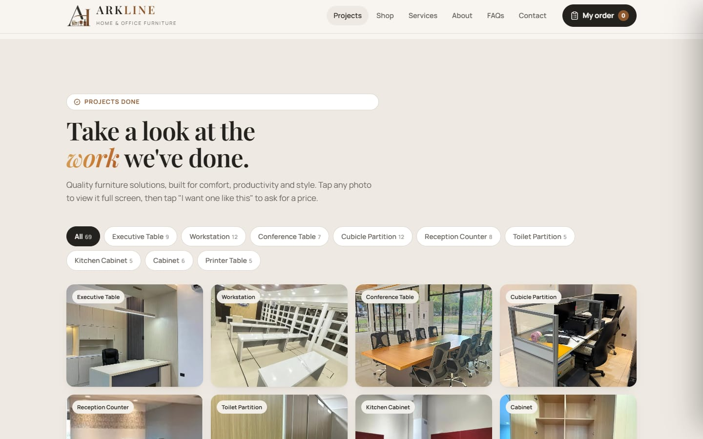 | **Browse 69+ finished projects** by category, full screen, with a swipeable viewer. Each category can show a "starts at" price. |
| 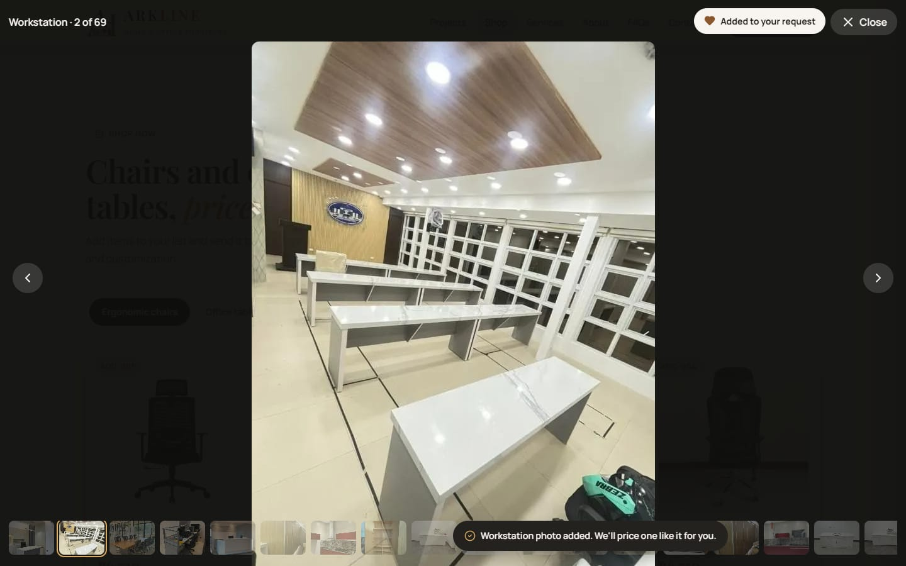 | **"I want one like this"** on any project photo attaches it to their request, so Arkline sees exactly what they mean. |
| 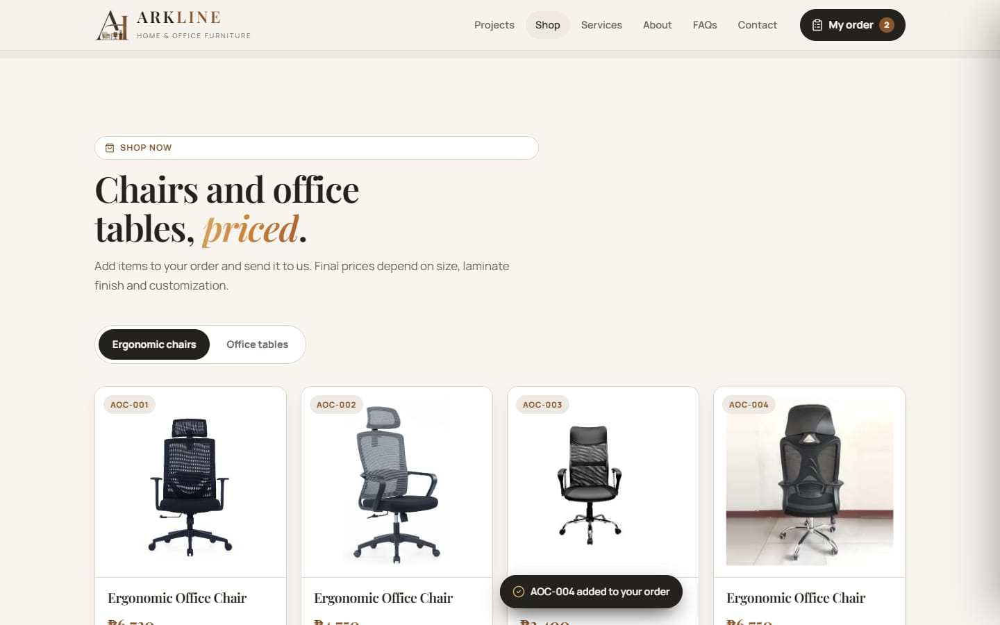 | **Shop chairs and tables** with live prices and scaled top-view drawings, then add items to an order. |
| 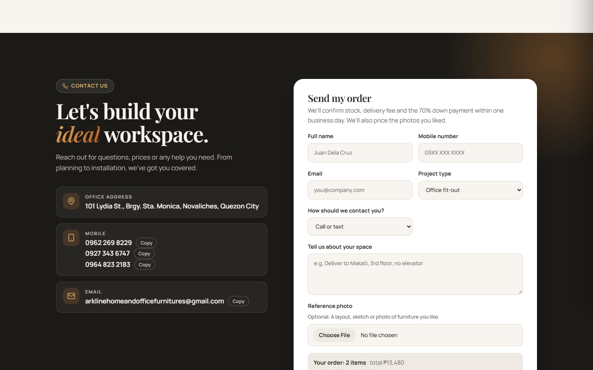 | **The form adapts:** shop items make it an **order**, custom work makes it a **price request**. Customers choose how to be contacted (call or text, Viber, Messenger, email) and get a reference number. |

Also: Messenger and Viber buttons, a fully responsive layout ([phone view](docs/screenshots/phone.jpg)), and plain wording for customers ("Ask for a price", not "Request a quotation").

## What the shop owner can do (`/admin`)

| | |
|---|---|
| 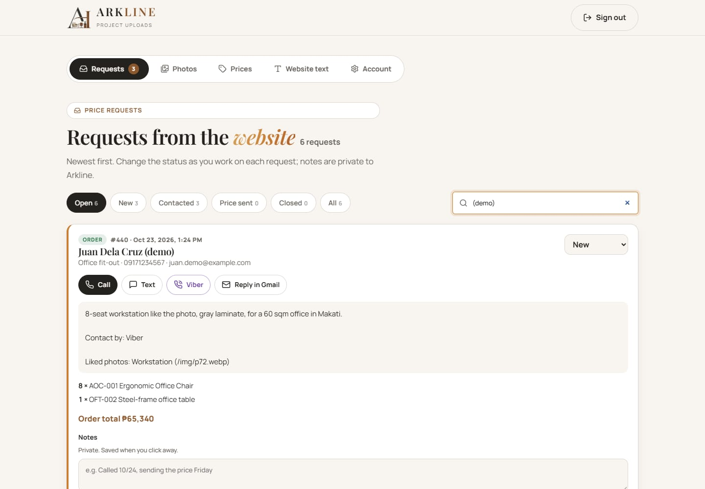 | **Requests inbox**: orders and price requests with status (New → Contacted → Price sent → Closed), search, private notes, liked photos, one-tap **Call, Text, Viber, Messenger** or **Reply in Gmail** with a drafted reply, Trash with restore, and a **Download** backup that opens in Excel. |
| 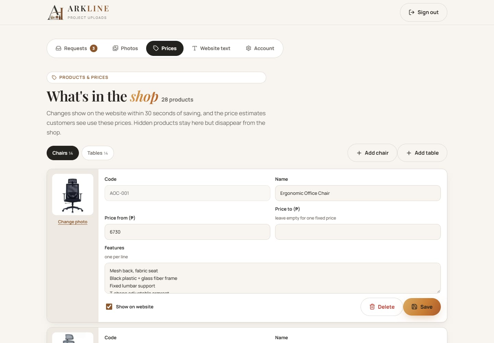 | **Prices**: edit, add, hide or delete products and photos. Quote estimates always use these prices, recalculated on the server. |
| 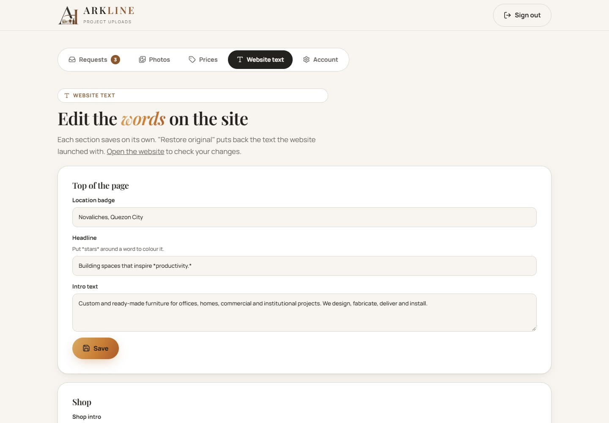 | **Website text**: edit the hero, services, steps, FAQs and contact details, with "Restore original" for each section. |
| 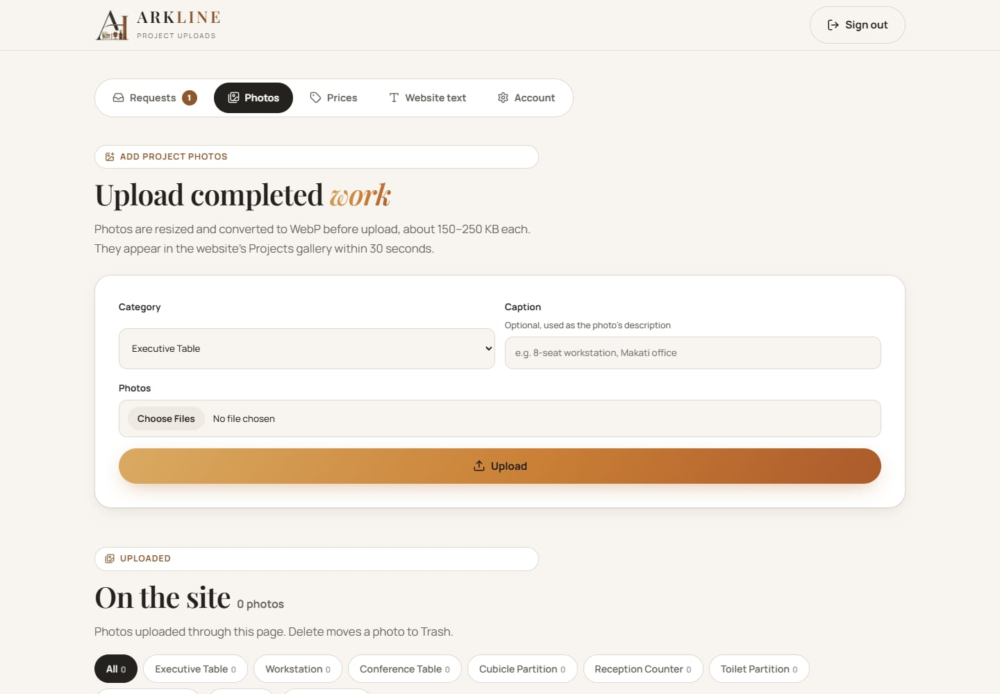 | **Photos**: upload from a phone (converted to WebP and **watermarked** in the browser, so competitors can't reuse them), Trash with restore, delete forever. |
| 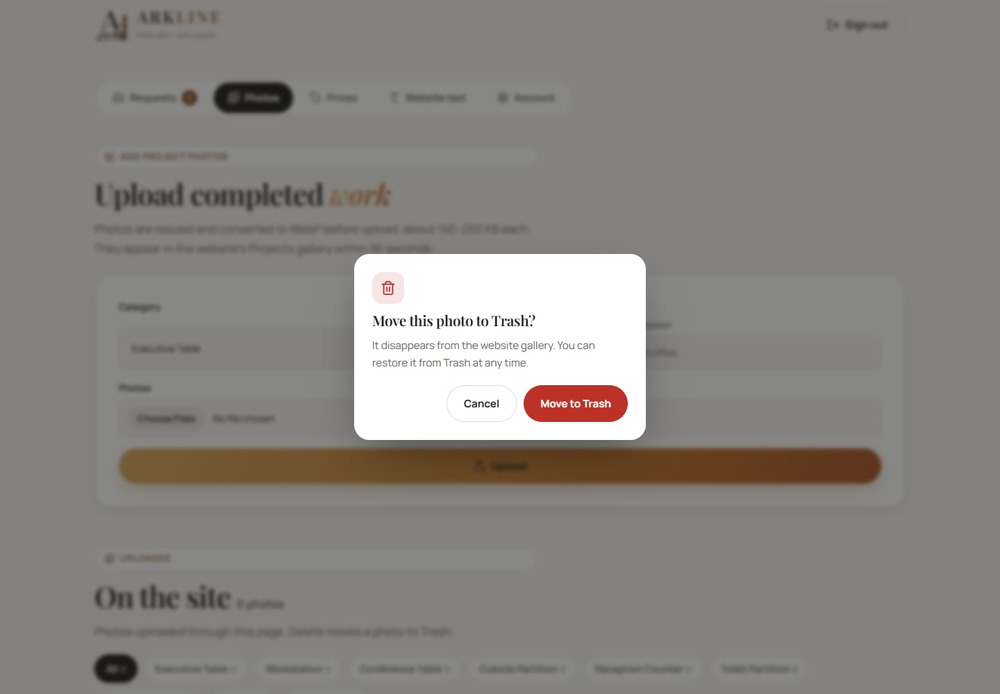 | **Safe by design**: branded confirmation before anything destructive, with Cancel pre-selected. |
| 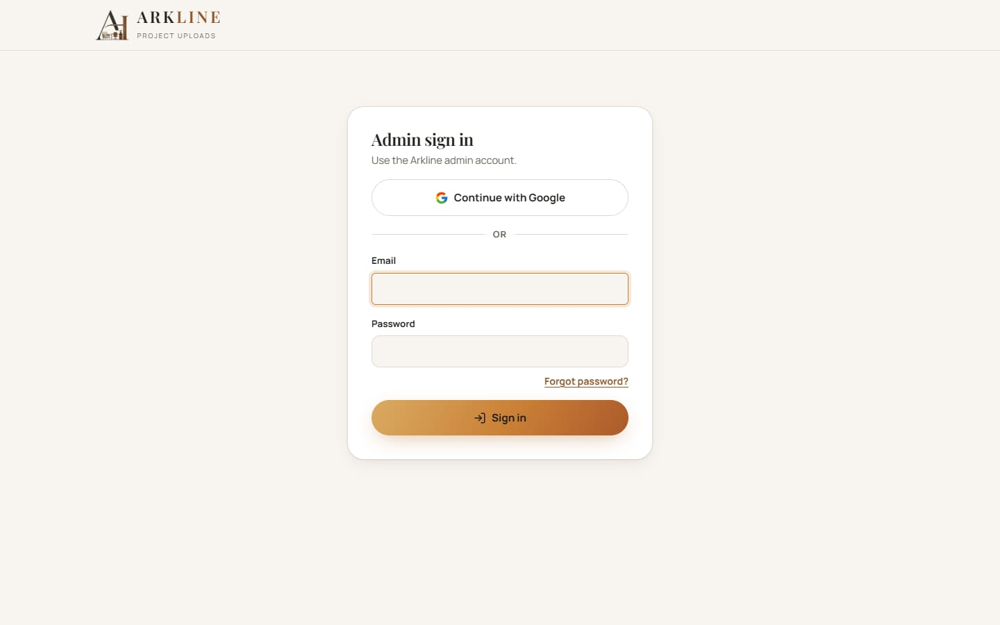 | **Sign-in**: Google or email and password, forgot password, and an Account tab to change the password or sign out on all devices. |

---

## Architecture

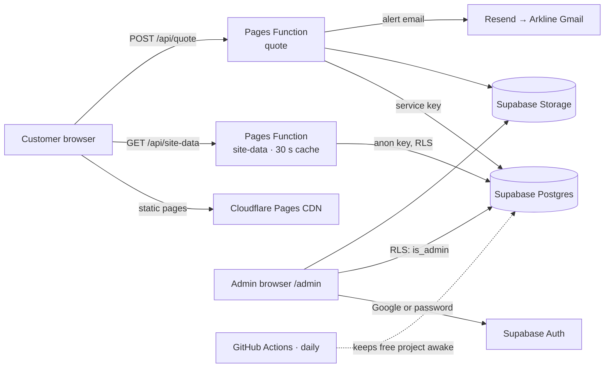

- **Public reads go through one cached endpoint.** `/api/site-data` returns the gallery, prices and text in one response, cached for 30 seconds. 100 visitors cost the database about one set of reads, and the public page doesn't need the Supabase library at all.
- **Writes from customers go through the server.** `/api/quote` validates every field, recalculates prices from the database, only accepts Arkline's own gallery photos as "liked" photos, rate-limits by IP, optionally checks Cloudflare Turnstile, then saves and emails Arkline.
- **The admin talks to Supabase directly**, protected by Row Level Security. Every table and storage bucket checks `public.is_admin()`, so the browser can't grant itself anything.
- **It degrades gracefully.** If the database is unreachable, the site falls back to built-in prices, text and photos and keeps working.

Design decisions are recorded in [ADR-001](docs/adr/ADR-001-vercel-supabase-stack.md).

---

## Performance

Measured on a throttled phone (1.6 Mbps, 4× slower CPU) and with a 100-user load test against the real database:

| | Before | After |
|---|---|---|
| Page fully loaded (phone) | 5.5 s | **3.4 s** |
| Data downloaded on first visit | 765 KB | **467 KB** |
| JavaScript on the public page | ~540 KB | **~40 KB** (16 KB gzipped) |
| 100 visitors opening the site at once | 2.1–3.4 s each | **0.15–0.41 s**, 0 errors |
| One order on a normal day | | **0.3–0.7 s** |

How: one cached data request instead of four database reads per visitor, 61 bundled icons instead of a 317 KB icon library, WebP images (6.4 MB → 3.1 MB), a slideshow that loads one photo ahead, lazy-loaded gallery images, and a 60-second price cache on the server.

## Security

- **Row Level Security on every table and bucket.** An attack test as an anonymous visitor and as a signed-in non-admin tried to read customers' requests, change prices, edit text, delete photos, upload files and promote itself to admin: **32 of 32 attempts were blocked**, verified in the database afterwards.
- **The server never trusts the browser.** Prices are recalculated server-side, only real gallery photos are accepted, uploads must be images under 5 MB, and project types are allow-listed.
- **No cross-site scripting.** Customer input is escaped everywhere it's displayed. A script hidden in a customer's name renders as plain text in the admin page (tested in a real browser).
- **Strict browser security headers:** Content-Security-Policy, no framing, HSTS, nosniff, Referrer-Policy and Permissions-Policy.
- **Spam limits:** 5 sends per IP per 10 minutes, a hidden honeypot field, and optional Cloudflare Turnstile.
- **Secrets stay server-side.** The service key exists only in server environment variables, never in the repo or the browser.

## Testing

End-to-end tests drive real Chrome against the real database, using throwaway accounts and test data that are deleted afterwards:

- **Customer and admin flow, 27 checks:** ordering, liked photos, contact rules, the admin inbox, status changes, prices, text and confirmations.
- **Security, 32 attack attempts:** plus form abuse, cross-site scripting under the production security policy, and the rate limit.
- **Account, 8 checks:** password change rules, and that the old password stops working.
- **Load:** 100 simultaneous visitors and 100 simultaneous orders.

---

## Project structure

```
index.html, admin.html         Pages (Vite multi-page build)
src/
  main.js, styles.css          Public site: gallery, shop, order/price form
  admin*.js, admin.css         Admin: requests, photos, prices, website text, account
  auth.js, confirm.js          Sign-in panel; confirmation dialog
  data.js, content.js          Built-in catalogue and text (fallback until the admin saves changes)
  icons.js, image.js           Bundled icons; in-browser WebP conversion
api/                           Host-neutral handlers: quote.js, site-data.js
functions/api/                 Cloudflare Pages Function wrappers
supabase/                      schema.sql, then migrations 002–006
public/                        Images, _headers (security and cache headers)
.github/workflows/             Daily ping that keeps the free Supabase project awake
docs/                          ADR, client flow PDF, screenshots, this README as a PDF
```

## Run it locally

```sh
npm install
cp .env.example .env.local     # fill in your Supabase values
npm run dev                    # http://localhost:5173 and /admin.html (the API runs in the dev server)
npm run build                  # production build to dist/
```

Without Supabase keys the site still runs on its built-in data, and the form works in demo mode (it logs to the terminal and saves nothing).

## Set up your own copy

1. **Supabase**: create a free project. In the SQL Editor, run `supabase/schema.sql`, then `002` to `006` in order.
2. **Admin**: under Authentication → Users, add the admin user. Run the `insert into public.admins …` line at the end of `schema.sql` with that email. Then turn off public sign-ups.
3. **Google sign-in (optional)**: create an OAuth client in Google Cloud with redirect URI `https://<project>.supabase.co/auth/v1/callback`, enable Google in Supabase, and add your site URLs under Authentication → URL Configuration.
4. **Deploy**: in Cloudflare Pages → Connect to Git, set the build command to `npm run build` and the output to `dist`, and add the environment variables below.

| Variable | Where it's used | Notes |
|---|---|---|
| `VITE_SUPABASE_URL`, `VITE_SUPABASE_ANON_KEY` | Browser and site-data | Public by design; RLS protects the data |
| `SUPABASE_URL`, `SUPABASE_SERVICE_ROLE_KEY` | `/api/quote` only | **Secret**: mark as encrypted |
| `RESEND_API_KEY`, `NOTIFY_EMAIL`, `NOTIFY_FROM` | New-request emails | Optional. Free without a domain if `NOTIFY_EMAIL` is your Resend login email |
| `VITE_TURNSTILE_SITE_KEY`, `TURNSTILE_SECRET_KEY` | Spam check | Optional, free |

Update the Supabase project URL in `public/_headers` (Content-Security-Policy) and `.github/workflows/keep-supabase-awake.yml` to match your project.

---

Built by [Laurence421](https://github.com/Laurence421). Photos, logo and business details belong to Arkline Home & Office Furniture.
